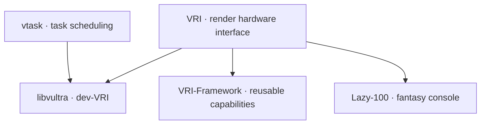

Vultra is a collection of graphics and engine projects that I maintain for research and game development. Current libvultra work takes place on **`dev-VRI`**. **`dev-next` was an experiment**, and its prototypes are separate from the current development branch.

## Origins

The work grew out of [Snow Leopard Engine](/projects/snow_leopard_engine/), an OpenGL group project from my MSc at Leeds, and the rendering tools I later needed for my PhD. I split reusable components into separate repositories so they could also be used by small applications and research prototypes.

## Design Principles

- Explicit rendering APIs and readable C++ / Slang code.
- Optional capabilities: a direct GPU program should not need an editor, ECS, importer or scripting host.
- Reusable tools and libraries with clear ownership.
- Offline asset and shader processing where it is useful, alongside runtime inspection and experiments.

## Why Not an Existing Solution?

I wanted a framework suited to my own graphics and VR experiments: explicit resource and synchronization control, portable shaders, OpenXR support, and small examples that can be read and changed directly. These requirements led to VRI and the related libraries.

## Architecture

The current libvultra branch uses VRI directly. VRI-Framework is a separate reusable library over the same RHI; it is not an intermediate dependency required by libvultra.

The shader, asset, filesystem and JSON render-graph projects below are standalone parts of the wider ecosystem. Their presence here does not imply that every one is a dependency of the current engine branch.

## libvultra — Graphics Framework {#libvultra}

| Branch | Role |
| --- | --- |
| [`dev-VRI`](https://github.com/zzxzzk115/libvultra/tree/dev-VRI) | Current development: a C++23 graphics framework built directly on VRI. |
| [`dev-next`](https://github.com/zzxzzk115/libvultra/tree/dev-next) | Experimental engine architecture and prototypes. |
| [`master`](https://github.com/zzxzzk115/libvultra/tree/master) | Earlier Vulkan-based implementation, with its own examples and documentation. |

The current development branch targets **Windows x64 and Linux x86_64 with Vulkan**. It includes explicit RenderGraph construction in C++ and JSON, Slang compilation and reload, scene import, raster rendering, offline experiments and a research workbench. Editor interfaces, native/Lua/C# scripting and XR examples are optional capabilities.

This is early development. Static geometry and an opaque OpenPBR material subset are the current documented scope. Broader backend support, gameplay authoring and delivery work should be read against the branch's [roadmap](https://github.com/zzxzzk115/libvultra/blob/dev-VRI/docs/roadmap.md), rather than inferred from the RHI's capabilities.

[Earlier libvultra examples](https://zzxzzk115.github.io/libvultra/) remain available. The screenshot above is from the current branch's glTF viewer; its sample assets retain the attribution recorded in that repository.

## VRI — Render Hardware Interface {#vri}

[VRI project page](/projects/vri/) · [Source](https://github.com/zzxzzk115/VRI) · [Browser examples](https://zzxzzk115.github.io/VRI/)

VRI provides an explicit rendering API through a C ABI and a C++23 wrapper. Backends cover Vulkan, D3D12, Metal, WebGPU and OpenGL-family APIs. Optional features are reported through capabilities; support varies by backend. Software Vulkan implementations support headless and GPU-less use.

VRI's backend coverage is broader than the current libvultra branch's supported target set. [Lazy-100](/projects/lazy_100/) is another application built on VRI.

## VRI-Framework — Reusable Rendering Capabilities {#vri-framework}

[VRI-Framework project page](/projects/vri-framework/) · [Public repository](https://github.com/zzxzzk115/VRI-Framework)

VRI-Framework supplies C++23 building blocks including RAII resources, presentation, a framegraph, GPU profiling, multi-queue submission and OpenXR lifecycle helpers. Applications compose these into their own renderer. The library has an example application loop and a host-driven render module.

It remains a separate project. Current libvultra `dev-VRI` uses VRI directly and acknowledges specific VRI-Framework asset conventions in its own documentation.

## vshadersystem — Shader Compilation {#vshadersystem}

[Project page](/projects/vshadersystem/) · [Source](https://github.com/zzxzzk115/vshadersystem)

The standalone Slang pipeline adds material reflection, keyword variants and precompiled shader libraries. Version 1.0 replaced the old INI-style GLSL DSL. Slang emits SPIR-V and WGSL directly; runtime consumers load the compiled files without a Slang dependency.

## vasset — Asset Pipeline {#vasset}

[Project page](/projects/vasset/) · [Source](https://github.com/zzxzzk115/vasset)

vasset imports meshes, textures and materials into engine formats, tracks assets with UUIDs and packages them into VPK archives. It includes a desktop CLI, virtual-filesystem integration and a WebAssembly import example.

## vrendergraph — JSON Pipeline Descriptions {#vrendergraph}

[Source](https://github.com/zzxzzk115/vrendergraph)

A standalone JSON render-pipeline schema and runtime builder, including resource descriptions, passes and optional editor metadata. It was used in the earlier data-driven pipeline experiments. Current `dev-VRI` documents its own RenderGraph interfaces and JSON construction separately.

## vbase — Foundation Utilities {#vbase}

[Source](https://github.com/zzxzzk115/vbase)

Shared utilities include IDs, result/error types, binary readers and writers, module and service registries, signals and events. The library is intended for reuse outside a single engine.

## vfilesystem — Filesystem Abstraction {#vfilesystem}

[Source](https://github.com/zzxzzk115/vfilesystem)

Filesystem interfaces, normalized paths, physical and memory backends, and a virtual-filesystem mount table. Higher-level asset loading and VPK packaging live in vasset.

## vtask — Task Scheduling {#vtask}

[Source](https://github.com/zzxzzk115/vtask)

A task-management library built on enkiTS. The current libvultra development branch uses it for parallel loading and import jobs.

## Where It's Going

My current work is on the `dev-VRI` graphics framework and research workflow. The branch's examples and roadmap are the reference for what is implemented, experimental or still planned.
